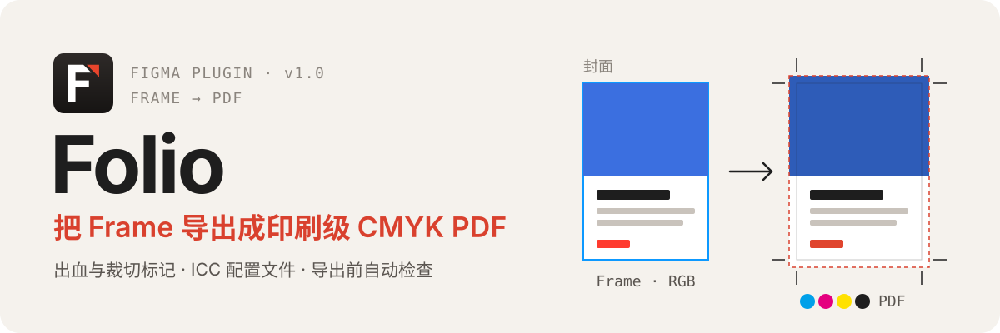
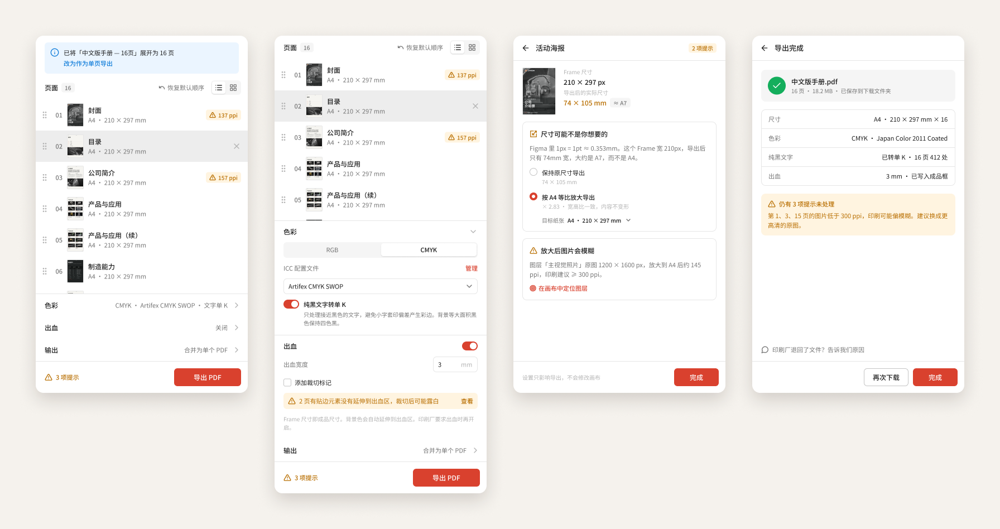

<p align="center">
  
</p>

<p align="center">
  <a href="#安装">安装</a> ·
  <a href="docs/PRD.md">产品文档</a> ·
  <a href="https://github.com/ZhanYiHui06/Folio/issues/new">反馈问题</a>
</p>

Figma 自带的 PDF 导出只有 RGB，也没有出血和裁切标记，交给印刷厂之前往往还要再进一遍 Illustrator 或 Acrobat。Folio 在 Figma 里把这一步做完：选中 Frame，检查一遍，直接得到印刷厂能收的 CMYK PDF。

<p align="center">
  
</p>

<p align="center"><sub>页面列表 · 色彩与出血设置 · 单页检查 · 导出报告</sub></p>

## 它做什么

**多页一次导出。** 选中多个 Frame、一个 Section 或装着多页的容器 Frame，Folio 会展开成页面列表。可以拖拽排序、临时移除某页，合并成一个多页 PDF，或者每页一个 PDF 打包成 zip。

**RGB 或 CMYK。** RGB 适合屏幕阅读和数码打印，完全离线。CMYK 用 Ghostscript 按 ICC 配置文件转换，可以把纯黑文字转成单 K，避免小字套印出彩边。

**出血与裁切标记。** 开启出血后，背景会自动延伸到出血区，并可加上裁切标记。Frame 尺寸就是成品尺寸，不用为出血改画板。

**导出前检查。** 每页都会检查这些容易被印刷厂退回的问题，点开能看原因，还能在画布上定位到对应图层：

- 尺寸不是常见纸张（例如按 1px = 1pt 算，210 px 宽的 Frame 只有 74 mm）
- 图片放大后低于 300 ppi
- 过细的线条、过小的文字
- 贴边元素没有延伸到出血区

## ICC 配置文件

| 来源 | 配置文件 |
|---|---|
| 内置 | Artifex CMYK SWOP |
| 随插件提供（colord，CC0） | FOGRA39、FOGRA47、GRACoL TR006、SWOP TR005 |
| 首次使用时从 [ICC Registry](https://registry.color.org/) 下载 | Japan Color 2011 Coated、PSO Coated v3 (FOGRA51)、GRACoL 2013 (CRPC6) |
| 自己导入 | 印刷厂给的任何 CMYK 输出配置文件（.icc / .icm） |

下载的文件都经过 SHA-256 校验。来源与许可见 [`profiles/NOTICE.md`](profiles/NOTICE.md)。

## 安装

Folio 已提交 Figma Community 审核，上线后会在这里放链接。在那之前可以用开发版：

1. 下载或克隆本仓库。`dist/` 里是构建好的文件，不需要自己构建。
2. 在 Figma 桌面版菜单里选 **Plugins → Development → Import plugin from manifest…**，选仓库根目录的 `manifest.json`。
3. 选中 Frame 或 Section，运行 **Plugins → Development → Folio – Frame to CMYK PDF**。

> [!NOTE]
> 第一次导出 CMYK 时，会在线下载色彩引擎（Ghostscript WASM，约 11 MB，来自 jsDelivr，备用 unpkg），并做 SHA-256 校验。RGB 导出不联网。设计文件始终留在本地，不会上传。

## 开发

```bash
npm ci
npm run watch      # 改代码后自动重建 dist/
npm run check      # 类型检查 + 单元测试 + 构建
```

改了 `src/` 之后请运行 `npm run build`，把 `dist/` 一起提交，CI 会检查两者是否一致。

<details>
<summary>目录结构</summary>

| 目录 | 内容 |
|---|---|
| `src/main/` | 插件主线程：读选区、做检查、克隆 Frame 导出 PDF（临时节点在 `finally` 里删除） |
| `src/ui/` | 界面（Preact）、导出流程、Ghostscript Worker、ICC 管理 |
| `src/lib/` | 与 Figma 无关的纯逻辑：纸张匹配、选区解析、ppi、ICC 解析、PDF 处理、Ghostscript 调用 |
| `profiles/` | 随插件提供的 CMYK 配置文件，构建时压缩内联 |
| `test/` | Vitest 单元测试，包含一次真实的 Ghostscript WASM 转换 |
| `assets/` | 插件图标与 README 配图 |
| `spike/` | 技术验证脚本（非产品代码） |

更多背景见 [技术验证报告](docs/spike-report.md) 和 [手动测试清单](docs/test-checklist.md)。

</details>

## 许可

[AGPL-3.0-or-later](LICENSE)，与插件内使用的 Ghostscript 一致。
